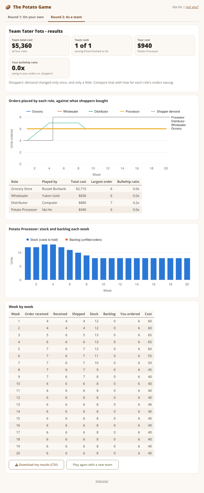

# The Potato Game

A supply-chain ordering game (a "beer game" with potatoes) for SCM 361 at BYU-Idaho.
R Shiny with a SQLite database. Built for a class of about 40 playing at once on their own phones or laptops.

Students play twice:

1. **Round 1, on your own.** Each student runs the Potato Processor. The computer runs the Grocery Store, Wholesaler and Distributor. At the end the student sees their own results and can download them.
2. **Round 2, as a team.** One student creates a team, the others join it and each take a role. The week turns over when every teammate has ordered. The results show the whole chain, so the team can see whether they tamed the bullwhip.

The instructor page shows live progress, a leaderboard for each round, a class debrief chart, and CSV exports.



## Rules

| | |
|---|---|
| Chain | Grocery Store ← Wholesaler ← Distributor ← Potato Processor |
| Length | 20 weeks (set per class) |
| Starting position | 12 units in stock, 4 arriving next week, 4 the week after |
| Shopper demand | 4 a week for weeks 1-4, then 8 (set per class) |
| Costs | $5 per unit in stock per week, $25 per unit of backlog per week (set per class) |
| Order delay | An order reaches the supplier the following week |
| Shipping delay | A shipment arrives two weeks after it is sent |
| Processor | Its order is a production run that reaches its own stock two weeks later |
| Score | Round 1: your own total cost. Round 2: the team's four costs added together. Lowest wins. |

Computer-run roles use the ordering rule Sterman (1989) fitted to real beer-game players: they forecast demand, try to rebuild stock, and under-count what is already on order. That is why they over-order the way people do. The constants are at the top of `R/engine.R`.

**Bullwhip ratio** in the results = variance of a role's orders ÷ variance of shopper demand. 1× means the role's orders were as steady as shoppers'; larger means the swings were amplified.

## Running a class

1. Open the app, click **Instructor** at the bottom, sign in.
2. **Create a new class**: pick a short class code (for example `SPUD1`). One class per section keeps the exports separate.
3. Put the instructor page on the projector. It shows the link and class code. Students enter the code and their name.
4. Round 1 starts as soon as a student joins. The Round 1 table is the live leaderboard.
5. When you are ready, click **Open the team round**. Students switch to the *Round 2* tab, one creates a team, the rest join and take roles, and anyone on the team starts the game. Roles nobody takes are played by the computer.
6. Use **Class debrief** for the discussion, and **Export** for the CSV files.

Things that happen in a real class:

- **A student closes the tab, the phone sleeps, or wifi drops.** Reopening the link on the same device returns them to the same week. On a different device, entering the same class code and the same name does too.
- **A teammate leaves mid-game and the team is stuck.** Pick the team in the Round 2 box and click *Computer takes over roles that haven't ordered*.
- **A student needs a fresh start in Round 1.** Pick them and click *Reset this student's Round 1*.
- **Teams larger than four.** The game has four roles and one person per role. Extra students can pair up on one device, or split into two teams.

### Exports

- **Results (CSV)**: one row per student per round: role, team, status, own cost, chain cost, score, rank, bullwhip ratio, weeks with a backlog, start and finish times (UTC).
- **Weekly detail (CSV)**: one row per game, week and role: order received, units received, units shipped, stock, backlog, order placed, cost, and whether the role was computer-run.

## Install on Shiny Server (Ubuntu)

```bash
git clone https://github.com/<you>/potato-game.git
cd potato-game
sudo bash deploy/install.sh
```

The script installs any missing R packages (`shiny`, `bslib`, `DBI`, `RSQLite`), copies the app to `/srv/shiny-server/potato`, asks for an instructor password, and gives the `shiny` user ownership. The app is then at `https://<your-server>/potato/`.

To install somewhere else: `APP_DIR=/srv/shiny-server/potatogame sudo -E bash deploy/install.sh`.

**Updating:** `git pull && sudo bash deploy/install.sh`. The `data/` folder (database and password) is left alone.

### Instructor password

Stored in `data/instructor_password.txt` inside the app folder (one line, readable only by `shiny`). To change it:

```bash
echo 'new-password' | sudo tee /srv/shiny-server/potato/data/instructor_password.txt
```

Alternatively set the environment variable `POTATO_ADMIN_PW`.

### Data

Everything is in `data/potato.sqlite` (set `POTATO_DB` to move it). It opens in SQLPad or any SQLite tool; the tables are `sessions`, `players`, `games`, `positions` and `history`. Back it up by copying the file. Neither the database nor the password is committed to git (see `.gitignore`).

### Capacity

Shiny Server (open source) runs one R process per app, and all 40 students share it. The app is written for that: browsers are notified in-process when a teammate acts rather than polling, the busy screens are built as plain strings, and charts use base graphics. Each order is one short SQLite transaction, so two teammates ordering in the same instant cannot both close a week.

`tests/load_test.py` plays 40 browsers through both rounds against a running copy. Run it once against your own server before the first class (from a different computer):

```bash
pip install playwright && playwright install chromium
python tests/load_test.py https://<your-server>/potato/ '<instructor password>' 40 LOADTEST
```

## Run locally

```r
install.packages(c("shiny", "bslib", "DBI", "RSQLite"))
Sys.setenv(POTATO_ADMIN_PW = "spud")
shiny::runApp(".")
```

Tests of the rules and database layer: `Rscript tests/test_game.R`

## Files

| | |
|---|---|
| `app.R` | Screens: join, play, team lobby, results, instructor |
| `R/engine.R` | The rules, with no database or Shiny code; start here to change the game |
| `R/db.R` | SQLite schema, transactions, exports |
| `R/charts.R` | Results charts |
| `www/` | Styles and a small script (remembers the player, sends orders) |
| `deploy/install.sh` | Install or update on Shiny Server |
| `tests/` | Rule tests and the load test |

To rename the roles, edit `ROLE_NAMES`, `ROLE_SHORT`, `ROLE_BUYS_FROM` and `ROLE_SELLS_TO` at the top of `R/engine.R`.
